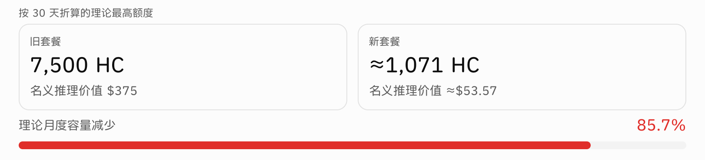
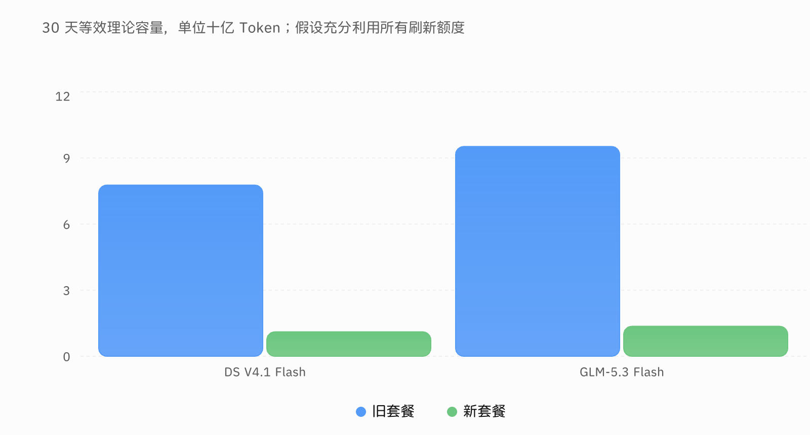
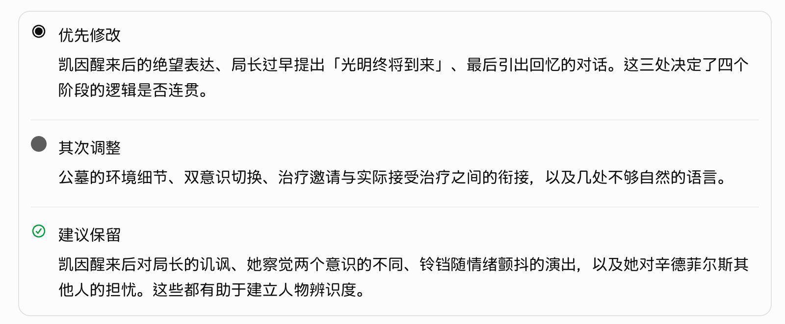
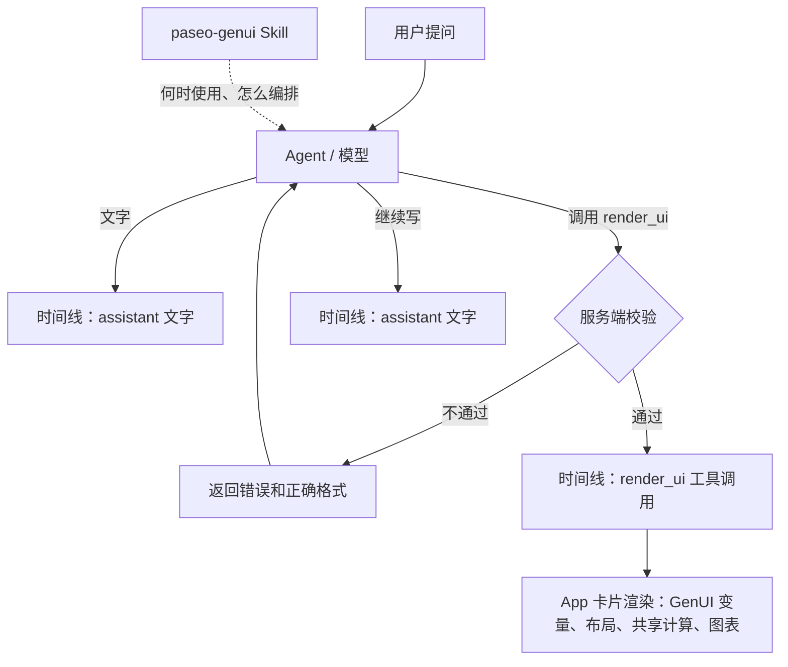

# Paseo GenUI：聊天内生成式界面

> **RFC v0.4**　2026-10-20　目标仓库：dandibbert/paseo（`main` @ `8d92b3c5`，版本 0.11.4）
> 状态：方案，尚未实现。相对上一版的改动见第 15 节。
> 本包内的配套文件见第 7、8 节；阅读顺序见包根目录 `README.md`。

## 0. 摘要

让 Agent 的回答里直接出现 Paseo 风格的卡片和图表，不再生成独立 HTML 文件再打开。

做法：在 Paseo 已有的工具目录里新增一个工具 `render_ui`。模型在回答中途调用它，传入声明式数据；Paseo 在时间线里把这次调用画成卡片，前后的文字照常显示，自然形成"文字、卡片、文字"。样式、布局、图表绘制和数值计算全部由 Paseo 负责，模型只给内容和数据。

三层分工：

1. **`render_ui` 工具**：薄参数，服务端严格校验，出错时把正确格式返回给模型当场改正。
2. **`paseo-genui` Skill**：何时该用、何时不该用、怎么编排，附完整示例。
3. **App 卡片渲染**：按 GenUI 视觉规范绘制，iOS、Android、Web、Electron 共用一套代码。

v1 共十个组件：`metricComparison`、`metric`、`progress`、`chart.bar`、`chart.line`、`chart.pie`、`table`、`priorityList`，以及组合容器 `card`、`grid`。

## 1. 背景

现在用 `answer-with-html` 一类 Skill：模型写 HTML/CSS，存成文件，用户离开聊天去打开。问题是：

- 结论和图表分在两处，打断阅读。
- 版式由模型现写，不同模型、不同次结果差别大。
- 远程 Agent、Relay、手机访问时，生成的文件还要再想办法打开。
- 结果不能复用聊天的历史、主题和复制等功能。

目标体验：值得可视化的地方，回答里自动出现精致的卡片或图表；其余部分仍是自然的文字。

## 2. 参考场景

| 场景       | 内容                                           | 验收重点                                                                                       |
| ---------- | ---------------------------------------------- | ---------------------------------------------------------------------------------------------- |
| A 额度变化 | 两张大数字卡、名义价值、红色降幅和变化条       | 7,500 → 1,071，降幅 85.7% 由共享计算得出；`changeIntent: "bad"` 显示为红色；宽屏双列、窄屏单列 |
| B 容量对比 | 分组柱状图、纵轴、网格线、图例、单位           | 窄宽度不溢出；点按或悬停能读到精确数值                                                         |
| C 修改建议 | 修改 / 调整 / 保留，带图标、分隔线、长中文段落 | 长文本自然换行，不把每条做成彩色卡片                                                           |
| E 构成占比 | 饼图（开发 46%、测试 27%、设计 17%、其他 10%） | 扇区比例正确，图例完整，窄屏不溢出                                                             |







E 没有参考图，按视觉规范的饼图规则实现。交互参数面板推迟到 v2。

## 3. 现有可复用的能力

| 位置                                                         | 现状                                                                                                                                                                           | 用途                                                         |
| ------------------------------------------------------------ | ------------------------------------------------------------------------------------------------------------------------------------------------------------------------------ | ------------------------------------------------------------ |
| `packages/server/src/server/agent/tools/paseo-tools.ts`      | Paseo 工具目录，已有 40 多个工具（`create_agent`、`list_workspaces`、`speak` 等）                                                                                              | 新增 `render_ui`                                             |
| `docs/architecture.md`（`supportsNativePaseoTools`）         | 能接原生工具的 provider 直接注入工具目录；其余通过 `/mcp/agents` 的 MCP 获得同一套工具                                                                                         | `render_ui` 自动到达所有 provider，包括 Pi、OpenCode、ACP    |
| `speak` 工具                                                 | 各 provider 解析器把它映射为 `ToolCallDetail`（type `unknown`，带文本）；`packages/app/src/agent-stream/view.tsx` 识别到 `speak` 就渲染成 `SpeakMessage`，不显示为普通工具调用 | `render_ui` 照这个模式实现，v1 不改协议                      |
| `packages/app/src/tool-calls/detail-level/grouping.ts`       | `speak` 被排除在普通工具分组之外（第 70 行）                                                                                                                                   | `render_ui` 同样排除，否则 Overview 模式下会被折叠进工具汇总 |
| `packages/protocol/src/tool-name-normalization.ts`           | `isPaseoToolName`、`getPaseoToolLeafName`，识别 `mcp__paseo__…` 等形式                                                                                                         | 识别 `render_ui` 时统一用它，不用字符串相等判断              |
| `packages/server/src/server/agent/paseo-tool-policy.ts`      | 按 provider 开关 Paseo 工具（`disabledTools`）                                                                                                                                 | 可对单个 provider 关掉 `render_ui`                           |
| `packages/server/src/server/agent/providers/claude/agent.ts` | 已缓冲 Claude 工具参数的 `input_json_delta` 片段                                                                                                                               | Claude 可以在生成中预览卡片                                  |
| `packages/server/src/server/orchestration-skills/`           | 内置 Skill 同步，递归复制整个 Skill 目录                                                                                                                                       | `skills/paseo-genui/` 连同 `references/` 一起分发            |
| `packages/app/package.json`                                  | 已有 `react-native-svg`                                                                                                                                                        | 图表三端共用一套实现                                         |

## 4. 架构



### 4.1 为什么用工具调用，不用 Markdown 代码块

|                          | 工具 `render_ui`                             | Markdown 代码块                        |
| ------------------------ | -------------------------------------------- | -------------------------------------- |
| 送到 Agent               | 已有工具目录自动注入所有 provider            | 依赖各 provider 发现 Skill，需逐个验证 |
| 格式错误                 | 生成时校验，模型当场改                       | 只能显示降级内容                       |
| 混排                     | 时间线天然按顺序排列                         | 要改 Markdown 分段器、原生选择和测量   |
| Web 32k 字符截断         | 不涉及                                       | 可能把 JSON 截成一半                   |
| 通知、标题、`paseo logs` | 不出现 JSON                                  | 会露出原始 JSON                        |
| 代价                     | 每张卡片多一次模型推理；工具说明每轮占 token | 无                                     |

代码块方案作为兜底，**v1 不做**。只有遇到拿不到 Paseo 工具的 provider 时再加。

### 4.2 混排

一次回答在时间线上是三个按顺序排列的条目：assistant 文字、`render_ui` 工具调用、assistant 文字。App 在渲染工具调用时识别 `render_ui`，画成卡片，与 `speak` 相同。

- 识别时做工具名归一化：用 `getPaseoToolLeafName` 同时匹配原生 `render_ui` 和 MCP 形式（如 `mcp__paseo__render_ui`），不用字符串相等判断。
- 在 `grouping.ts` 中把 `render_ui` 排除在普通工具分组之外，与 `speak` 相同，保证 Overview 模式下卡片独立显示。

**M0 先验证**：模型在回答中途调用工具时，各 provider 是否确实把前后文字拆成两个条目。

### 4.3 推荐代码位置

```text
packages/protocol/src/genui/
  compute.ts                     # 派生值（changePercent、进度比例、饼图百分比），服务端与 App 共用
packages/protocol/src/tool-name-normalization.ts
                                 # 已有；识别 render_ui 时使用

packages/server/src/server/agent/tools/
  paseo-tools.ts                 # 注册 render_ui；工具说明含十个组件的最简格式
  render-ui/
    schema.ts                    # 各组件的严格 Zod Schema，与 schemas/render-ui.v1.schema.json 对齐
    validate.ts                  # 校验、生成给模型的错误说明与正确格式
    limits.ts                    # 大小、嵌套、数据点上限
packages/server/src/server/agent/providers/*/tool-call-detail-parser.ts
                                 # 照 speak 的写法映射 render_ui

packages/app/src/genui/
  render-ui-card.tsx             # 时间线入口，在 agent-stream/view.tsx 中挂载
  tokens.ts                      # GenUI 设计变量（亮/暗两套），取自 genui-visual-spec.md
  components/                    # metricComparison、chart.bar 等
  charts/                        # react-native-svg 绘制
  preview/                       # 开发用静态预览页（见 §12）
packages/app/src/tool-calls/detail-level/grouping.ts
                                 # 把 render_ui 排除在工具分组之外

skills/paseo-genui/
  SKILL.md
  references/components.md       # 十个组件的完整格式与示例
  references/golden-examples.md  # A/B/C 完整回答示例
```

本设计包里的 `schemas/`、`tests/` 是设计阶段的校验依据，实现时转成仓库内的 Zod Schema 和 vitest 用例，不原样放进仓库。

## 5. `render_ui` 协议 v1

### 5.1 参数与最简格式

```ts
render_ui({
  type: "metricComparison" | "metric" | "progress" | "chart.bar" | "chart.line"
      | "chart.pie" | "table" | "priorityList" | "card" | "grid",
  title?: string,
  data: object,          // 工具层不约束，由服务端按 type 严格校验
  fallbackText?: string, // 通知、日志、旧客户端显示的纯文本摘要；Skill 要求默认提供
  schemaVersion?: 1,     // 可选，省略按 1 处理
})
```

- 组件的完整格式不写进参数 Schema。每个组件的**最简格式**写在 `render_ui` 的工具说明（description）里，十个合计约 300 token。工具说明与 `SKILL.md` 的表格必须逐字一致，内容如下：

| type               | `data` 的最小结构（省略可选字段）                                                                                               |
| ------------------ | ------------------------------------------------------------------------------------------------------------------------------- |
| `metricComparison` | `{items:[{id,label,value,unit?},…],compare:{from,to,metric:"changePercent",precision?,changeIntent?:"good"\|"bad"\|"neutral"}}` |
| `metric`           | `{label,value,unit?,detail?}`                                                                                                   |
| `progress`         | `{label,current,total,unit?}`，`total>0`                                                                                        |
| `chart.bar`        | `{x,series:[{field,label}],rows:[{[x]:类别,[field]:数值}],yUnit?}`                                                              |
| `chart.line`       | 与 `chart.bar` 相同；`rows` 必须已经按时间/步骤排序                                                                             |
| `chart.pie`        | `{labelField,valueField,rows:[{[labelField]:名称,[valueField]:非负数}],unit?}`                                                  |
| `table`            | `{columns:[{field,label}],rows:[{[field]:值}]}`                                                                                 |
| `priorityList`     | `{items:[{decision:"change"\|"adjust"\|"keep",priority?:"high"\|"medium"\|"low",title,body}]}`                                  |
| `card`             | `{children:[{type,title?,data},…]}`，语义相关的少量子组件                                                                       |
| `grid`             | `{children:[{type,title?,data},…]}`，同类并列实体，自动响应式                                                                   |

- 表中 `[x]`、`[field]` 是说明用记法，表示"取 `x` 字段的值作为键名"，不是实际 JSON 键。
- 完整格式在服务端 `render-ui/schema.ts`；校验失败时连同正确格式和示例一起返回。
- `card` 和 `grid` 是组合容器，最多嵌套两层。

### 5.2 场景示例

以下 JSON 均通过本包 `schemas/render-ui.v1.schema.json` 与 `tests/verify.py` 校验。

**A：metricComparison**

```json
{
  "type": "metricComparison",
  "title": "按 30 天折算的理论最高额度",
  "data": {
    "items": [
      {
        "id": "old",
        "label": "旧套餐",
        "value": 7500,
        "unit": "HC",
        "detail": "名义推理价值 $375"
      },
      {
        "id": "new",
        "label": "新套餐",
        "value": 1071,
        "unit": "HC",
        "detail": "名义推理价值约 $53.57"
      }
    ],
    "compare": {
      "from": "old",
      "to": "new",
      "metric": "changePercent",
      "precision": 1,
      "changeIntent": "bad"
    }
  },
  "fallbackText": "旧套餐 7,500 HC，新套餐约 1,071 HC；按相同口径，理论额度减少约 85.7%。"
}
```

**B：chart.bar**

```json
{
  "type": "chart.bar",
  "title": "30 天等效理论容量",
  "data": {
    "description": "单位：十亿 Token；假设充分利用所有刷新额度",
    "x": "model",
    "series": [
      {
        "field": "old",
        "label": "旧套餐"
      },
      {
        "field": "new",
        "label": "新套餐"
      }
    ],
    "rows": [
      {
        "model": "DS V4.1 Flash",
        "old": 7.8,
        "new": 1.1
      },
      {
        "model": "GLM-5.3 Flash",
        "old": 9.5,
        "new": 1.4
      }
    ],
    "yUnit": "十亿 Token"
  },
  "fallbackText": "DS 新旧容量分别为 1.1 与 7.8 十亿 Token；GLM 新旧容量分别为 1.4 与 9.5 十亿 Token。"
}
```

**C：priorityList**

```json
{
  "type": "priorityList",
  "data": {
    "items": [
      {
        "decision": "change",
        "priority": "high",
        "title": "优先修改",
        "body": "凯因醒来后的绝望表达、局长过早提出「光明终将到来」、最后引出回忆的对话。这三处决定了四个阶段的逻辑是否连贯。"
      },
      {
        "decision": "adjust",
        "priority": "medium",
        "title": "其次调整",
        "body": "公墓的环境细节、双意识切换、治疗邀请与实际接受治疗之间的衔接，以及几处不够自然的语言。"
      },
      {
        "decision": "keep",
        "title": "建议保留",
        "body": "凯因醒来后对局长的讥讽、她察觉两个意识的不同、铃铛随情绪颤抖的演出，以及她对辛德菲尔斯其他人的担忧。"
      }
    ]
  },
  "fallbackText": "优先修改阶段连贯性相关表达；其次调整场景、意识转换与治疗衔接；保留人物讥讽、铃铛演出与对他人的担忧。"
}
```

**E：chart.pie**

```json
{
  "type": "chart.pie",
  "title": "任务时间分布",
  "data": {
    "description": "示例数据：四类任务的时间占比",
    "labelField": "stage",
    "valueField": "percent",
    "rows": [
      {
        "stage": "开发",
        "percent": 46
      },
      {
        "stage": "测试",
        "percent": 27
      },
      {
        "stage": "设计",
        "percent": 17
      },
      {
        "stage": "其他",
        "percent": 10
      }
    ],
    "unit": "%"
  },
  "fallbackText": "开发占 46%，测试占 27%，设计占 17%，其他占 10%。"
}
```

### 5.3 变化含义：`changeIntent`

`metricComparison.data.compare.changeIntent` 可选，取值 `good`、`bad`、`neutral`，表示这个变化**对用户**是好事、坏事还是中性。

- App 据此给变化值和变化条上色：`bad` 危险色，`good` 成功色，`neutral` 或省略为次要文字色。
- 由模型按上下文判断，不按数值正负：额度、收入减少通常是 `bad`；成本、报错、延迟减少通常是 `good`；判断不了就省略。
- 模型仍不能指定任何具体颜色。

### 5.4 数据规则与上限

- 颜色只由语义决定（如 `changeIntent`、`priorityList.decision`），不接受 CSS、HTML、脚本、像素值、字体。
- 能由数据算出的值（比例、变化、合计、百分比）由 `compute.ts` 计算，模型只给原始数值。
- 缺失值用 `null`，显示为缺失，不补零；`NaN`、`Infinity` 直接拒绝。
- `chart.bar` / `chart.line` 的系列必须同一单位；`chart.line` 的行必须已按时间或步骤排序；`chart.pie` 只接受非负值，`unit` 为 `%` 时合计应接近 100。
- 上限（初始值，原型实测后调整）：单次调用参数 ≤ 16 KiB，嵌套 ≤ 2 层，bar/line ≤ 200 个数据点，pie ≤ 24 类，表格 ≤ 50 行。

### 5.5 工具返回值

- 成功：

  ```json
  {
    "ok": true,
    "accepted": true,
    "type": "metricComparison",
    "derived": { "changePercent": -85.7 }
  }
  ```

  - `accepted` 只表示服务端确认参数合法，不代表某个 App 已经显示卡片。
  - `derived` 只包含模型解释时需要的派生值，由 `compute.ts` 计算，与卡片显示一致；不回显原始数据。
  - `changePercent` 为 `(to - from) / from × 100`，负数表示减少；`from` 为 0 时返回 `derived: {"unavailableReason": "zero_baseline"}`。

- 失败：返回错误路径、原因，以及该组件的正确格式和示例；不返回 `derived`。

## 6. 流式体验

一张卡片有三种状态：

| 状态     | 显示                                                                                                                                                                                                                                   |
| -------- | -------------------------------------------------------------------------------------------------------------------------------------------------------------------------------------------------------------------------------------- |
| 生成中   | 按 `type` 显示骨架。Claude 能拿到不完整的工具参数，可做预览，但只显示**已经完整且通过该字段校验**的部分，例如标题字符串已闭合才显示标题，某张指标卡的 `label` 和 `value` 都有效才显示这张卡；其他 provider 多半只显示骨架，M0 逐个确认 |
| 校验通过 | 只用服务端校验后的数据渲染正式卡片，与历史重开时一致                                                                                                                                                                                   |
| 校验失败 | 卡片收起，不残留错误内容，等待模型重试                                                                                                                                                                                                 |

预览只显示逐字段确认有效的内容，所以正式卡片与预览一致的部分不会变化；校验失败多数发生在整体结构层面（例如缺少必填字段），此时收起的是骨架，用户看到的是"出现骨架后收起"，而不是一张卡片闪现后消失。

骨架高度：

- 骨架按 `type` 使用预估高度，作为卡片的**最小高度**。
- 生成中与校验通过时，卡片高度只增不减，避免聊天列表跳动。最终内容比预估矮时，保持最小高度，内容在卡片内顶部对齐。
- 校验失败是唯一允许缩小的情况：卡片收起到 0。
- 图表（bar、line、pie）高度按容器宽度取值：宽度 ≥ 600px 时 432px；更窄时取宽度的 0.72 倍，最小 280px。初始值，M2 在 iOS 实测后调整。

## 7. Skill

`skills/paseo-genui/` 以本包内的版本为准：

| 文件                            | 内容                                                                     | 何时进入模型上下文        |
| ------------------------------- | ------------------------------------------------------------------------ | ------------------------- |
| `SKILL.md`（约 4KB）            | 何时用、何时不用、编排、最简格式表、数值与 `changeIntent` 规则、重试规则 | 模型决定使用 GenUI 时加载 |
| `references/components.md`      | 十个组件的完整格式、字段约束与示例                                       | 字段不确定时按需读取      |
| `references/golden-examples.md` | A/B/C 完整回答：开头一句 → `render_ui` 调用 → 收尾一句                   | 复现参考场景时按需读取    |

要点：

- **默认不用**；一次回答通常 0 到 2 个组件；不要把每段话做成卡片。
- **数值一致性**：正文提到派生值时，引用工具返回的 `derived`；没有返回时只描述方向。
- **`changeIntent`**：按变化对用户的意义填写，判断不了就省略。
- 校验失败最多重试 2 次，仍失败就用 Markdown 完整回答；不生成 HTML 文件。
- 每次调用附可独立阅读的 `fallbackText`。

开发者文档 `docs/genui-generation-guidelines.md` 是 Skill 的完整依据和评测说明，不注入模型上下文。

## 8. 视觉与平台

- 尺寸、字号、圆角、间距、配色**全部**以 `docs/genui-visual-spec.md` 为准（ChatGPT 网页版实测，亮/暗两套，尺寸相同、只有颜色不同）。
- 实现为一套独立的 GenUI 设计变量（`packages/app/src/genui/tokens.ts`，亮/暗两套），GenUI 组件只读这套变量，不混用 Paseo 主题颜色；亮暗切换跟随 Paseo 当前主题。卡片外的 Paseo 界面不受影响；整个 App 是否向这套规范靠拢另开议题。
- 关键值摘要（详细值见规范文件）：
  - 卡片：1px 边框，圆角 16，内边距 12；卡片内子块用浅底，圆角 12，最多两层。
  - 文字：正文 16/26；指标数字 24/32、600 字重、等宽数字；标签 12/16 次要色。
  - 进度条与变化条：高 7px，全圆角，填充为语义色 85% 透明度。
  - 柱状图：柱顶圆角 8，同组柱间隔 4px；系列色亮暗各一套（亮：#539AF8、#6BC67F、#EF8B57、#F8D45D）。
  - 饼图：扇区间 2px 分隔描边，配色同图表系列。
  - 网格线：5% 透明度、虚线 3/3，无轴线。
  - priorityList：图标按 `decision` 区分（参考图 C），`priority` 不显示徽标，只用于排序和无障碍朗读。
- 验收标准、截图矩阵和评分在 `docs/genui-visual-acceptance.md`。
- 图表用 `react-native-svg` 自己画，三端共用。不用 Skia（Web 端要加载 wasm，对聊天消息太重）。
- 按卡片容器的实际宽度响应：宽屏双列，窄屏单列；图表长标签在窄屏换行或旋转。
- 每张卡片提供"复制为文字"（使用 `fallbackText` 或由数据生成）和"查看数据"。
- 平台顺序：先 Electron 和 Web 跑通，iOS 紧随其后，再 Android。

## 9. 安全

- 工具参数视为不可信输入，只接受白名单组件和字段，文字一律按纯文本渲染。
- 不执行脚本，不加载模型给出的远程资源（v1 不支持图片组件）。
- 超出上限的参数直接拒绝并告诉模型原因。
- `render_ui` 只负责展示，不执行写文件、付款、发送消息等副作用。
- 渲染出错时由 ErrorBoundary 兜住，显示 `fallbackText`，不影响前后文字。

## 10. 成本与开关

- **固定成本**：`render_ui` 的参数定义加十行最简格式，约几百 token，在已有 40 多个 Paseo 工具定义的基础上是小增量。原型阶段实测具体数字。
- **前缀缓存**：工具定义位于请求开头，Claude 和 OpenAI 都会缓存，命中部分按较低价格计。订阅套餐的额度如何计算缓存部分，需另行确认。
- **每张卡片的代价**：模型要等工具返回后才能继续写，多一次推理。Skill 要求克制使用。
- **开关**：
  - 用现有 `disabledTools` 按 provider 关掉 `render_ui`。
  - App 设置里提供"GenUI 渲染"开关；关闭时把 `render_ui` 显示为普通工具调用，内容为 `fallbackText`。

## 11. 降级

1. 校验通过 → 渲染卡片。
2. 校验不通过 → 错误返回模型重写。失败的调用在时间线里不显示卡片（不残留），只显示后续成功的那张卡片。
3. 渲染时出错 → 显示 `fallbackText`，附"查看数据"。
4. 旧版 App → 显示为普通工具调用，可展开看到原始参数。
5. Provider 关掉了 `render_ui`，或重试 2 次仍失败 → 模型用 Markdown 回答。

## 12. 范围与里程碑

### v1 范围

- **组件**：`metricComparison`、`metric`、`progress`、`chart.bar`、`chart.line`、`chart.pie`、`table`、`priorityList`，组合容器 `card`、`grid`。
- **不做**：交互控件、派生计算表达式、`sendAgentPrompt`、图片、地图、代码块兜底。
- **之后按实际需要加**：时间线、步骤列表、代码对比、slider 和 select。每加一个只扩充组件名列表、最简格式表和服务端 Schema。

### M0：验证（先做）

- [ ] 在 Claude、Codex、Pi 上让模型中途调用一个工具，确认时间线显示为"文字、工具调用、文字"三项。
- [ ] 确认 `render_ui` 调用在各 provider 的默认模式下不弹权限确认；顺带检查给工具加 `readOnlyHint` 注解是否有效。
- [ ] 确认各 provider 能否拿到不完整的工具参数。
- [ ] 量出 `render_ui` 增加的 token 数。
- [ ] Overview 模式下 `render_ui` 卡片独立显示，不被折叠。
- [ ] Daemon 重启并重新读取历史后，卡片正确恢复。
- [ ] Codex 和 ACP 适配器能否接受不受约束的 `data: object`；不能则改为 `data` 传 JSON 字符串，由服务端解析。
- [ ] 花半天对比 Google A2UI 和 Vercel json-render 的节点设计与流式格式，决定是否借鉴。

Overview 模式和 Daemon 重启这两项不通过，不得开始 M1。

### 静态预览页（可与 M0 并行）

- [ ] 在 App 内做一个开发用静态预览页（`packages/app/src/genui/preview/`），直接用本包 `tests/fixtures/` 的十份 JSON 渲染组件，支持亮/暗、宽/窄切换，与参考图对照调整。不依赖 `render_ui` 管线和任何 provider。

### M1：场景 A、B、C 在 Web 和 Electron 上完成

- [ ] `packages/protocol/src/genui/compute.ts`：共享派生值计算，带单元测试（含 `zero_baseline`、四舍五入）。
- [ ] 服务端：`render_ui` 注册、工具说明（最简格式表）、严格校验、错误返回、上限、`derived` 返回值。
- [ ] 各 provider 解析器照 `speak` 的写法映射 `render_ui`；工具名归一化；工具分组排除。
- [ ] App：GenUI 设计变量、卡片骨架与三种状态、`metricComparison`（含 `changeIntent` 上色）、`chart.bar`、`priorityList`、宽窄适配。
- [ ] Skill 按本包内容放入 `skills/paseo-genui/`。
- [ ] Claude 的生成中预览。

### M2：补齐 v1 组件，上 iOS 和 Android

- [ ] `metric`、`progress`、`chart.line`、`chart.pie`、`table`、`card`、`grid`。
- [ ] iOS、Android 实测：列表高度测量、滚动、明暗主题、大字号、窄屏图表高度。
- [ ] 复制为文字、查看数据、App 端开关。
- [ ] 用本包 `tests/generation-cases.json` 的 20 个用例统计各模型的一次通过率和平均重试次数。其中 T03 要求 `changeIntent: "bad"`，T12 要求 `chart.pie`，T14 要求 `changeIntent` 为 `"good"` 或省略。

### 之后

按 M2 的统计和实际使用情况决定加哪些组件、是否做交互、是否需要代码块兜底。若需要稳定的协议字段（例如专门的 `ToolCallDetail` 类型），按 `docs/protocol-compatibility.md` 增量添加并打 `COMPAT` 标记。

## 13. 验收

1. 一次回答为"文字、卡片 A、文字、卡片 B、文字"，顺序正确，历史重开后一致。
2. 卡片 A 的 85.7% 由共享计算得出；正文中出现的降幅与卡片显示一致。
3. 卡片 A 的降幅为红色（`changeIntent: "bad"`）；同类卡片换成成本下降并填 `"good"` 时为绿色。
4. 卡片 B 在窄宽度不溢出，点按或悬停能读到精确数值。
5. 卡片 C 长中文段落正常换行。
6. 饼图 E 扇区比例正确，图例完整。
7. 故意传错参数，模型收到错误后能重写成功；聊天里不出现坏卡片。
8. 关闭 `render_ui` 后，模型照常用 Markdown 回答。
9. 推送通知、Agent 标题、`paseo logs` 不出现原始 JSON。
10. Claude、Codex、Pi 至少各跑通一次场景 A、B、C。
11. 参数里写 HTML、`javascript:` 链接、超大数组，都被拒绝且不影响聊天。
12. 普通问答默认不出现卡片。
13. 满足 `docs/genui-visual-acceptance.md` 的 v1 通过条件，包括 A、B、C 与参考图并排对比，由用户确认通过。

## 14. 待确认

1. 混排是否在所有 provider 上都拆成三项（M0）。
2. `render_ui` 在各 provider 的权限策略（M0）。
3. 哪些 provider 能拿到不完整的工具参数（M0）。
4. 实际 token 增量，以及订阅套餐对缓存部分的计量方式。
5. 卡片在聊天列表里的高度：已定方案（预估高度为最小高度，生成中与校验通过时只增不减，校验失败时收起），M1 实测验证；窄屏图表高度 M2 在 iOS 实测调整。
6. Codex 和 ACP 能否接受不受约束的 `data: object`（M0）。

## 15. 相对上一版的改动

### v0.4

- **饼图纳入 v1**：`chart.pie` 加入组件列表，v1 共十个组件；T12 从 unsupported 改为要求 `chart.pie`。
- **priorityList 拆成两个字段**：`decision`（`change` / `adjust` / `keep`）表示改不改，`priority`（`high` / `medium` / `low`，可选）表示多紧急；取代 v0.3 的 `level`。
- **新增 `changeIntent`**：`metricComparison.compare.changeIntent`（`good` / `bad` / `neutral`）决定变化值和变化条的颜色，不按数值正负。
- **工具返回值**：改为 `{ok, accepted, type, derived}` JSON，`accepted` 明确只表示参数被接受。
- **字段命名**：表格列用 `field`，与图表 `series.field` 统一。
- **共享计算**：统一为 `packages/protocol/src/genui/compute.ts`。
- **版本字段**：`schemaVersion` 可选，默认 1（v0.3 曾计划不加）。
- **上限**：补充 pie ≤ 24 类。
- **最简格式只有一份**：工具说明与 `SKILL.md` 表格逐字一致，本文 §5.1 原样引用。
- **视觉文档**：`genui-visual-spec.md`（实测数值）为唯一视觉数值来源，补充 `changeIntent` 上色、变化条、饼图、priorityList 图标规则；验收清单独立为 `genui-visual-acceptance.md`，取代上一版 `genui-visual-quality.md`。
- **设计包**：Skill、组件参考、黄金示例、Schema、测试样例、生成规范、视觉文档与本 RFC 统一到同一套协议，`tests/verify.py` 交叉校验。

### v0.1 → v0.3.1

| 方面       | v0.1                                     | v0.2                                         | v0.3 / v0.3.1                                                                     |
| ---------- | ---------------------------------------- | -------------------------------------------- | --------------------------------------------------------------------------------- |
| 载体       | Markdown 代码块 `paseo-ui`               | Paseo 工具 `render_ui`；代码块为兜底，暂不做 | 不变                                                                              |
| 混排       | 改造 Markdown 渲染器，提炼块注册表       | 时间线天然顺序；App 照 `speak` 识别并渲染    | 识别时做工具名归一化；`render_ui` 排除在工具分组之外                              |
| 校验       | 渲染时校验，失败显示降级                 | 生成时校验，错误返回模型当场改               | 不变                                                                              |
| Schema     | 完整组件规范放在 Skill                   | 薄 Schema 加服务端严格校验                   | 工具说明里加每个组件一行最简格式                                                  |
| 工具返回值 | 无                                       | `rendered <type>`                            | 附带派生值；计算服务端与 App 共用                                                 |
| 数值一致性 | App 计算派生值                           | 正文不重复写这些值                           | 正文引用工具返回的数值                                                            |
| 流式       | 代码块关闭后整体渲染                     | 先出骨架；Claude 增量填充                    | 三种状态；预估高度为最小高度；校验失败收起                                        |
| 组件范围   | 60 种以上语义能力                        | v1 九个                                      | 不变                                                                              |
| 交互       | v1 含状态机、派生计算、`sendAgentPrompt` | 推迟到 v2                                    | 不变                                                                              |
| 视觉       | Paseo 主题                               | Paseo 主题，`react-native-svg` 画图          | ChatGPT 实测规范作为独立 GenUI 变量；静态预览页；截图对比验收；窄屏图表高度按宽度 |
| M0 验证    | 无                                       | 混排、权限、流式参数、token、方案对比        | 新增 Overview、Daemon 重启、Codex/ACP `data: object`、`readOnlyHint`              |
| Skill      | 完整组件规范                             | 只讲何时使用，附示例                         | 以 GPT 生成版为底稿；`references/` 放完整回答示例                                 |

明确不做：`get_ui_schema` 工具、薄/厚 Schema 对比测试、拆成两个独立开关、v0.1 的 60 多种组件清单附录。
